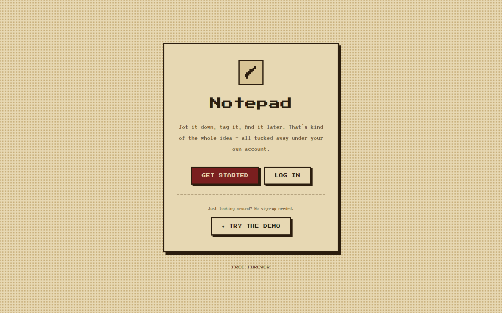
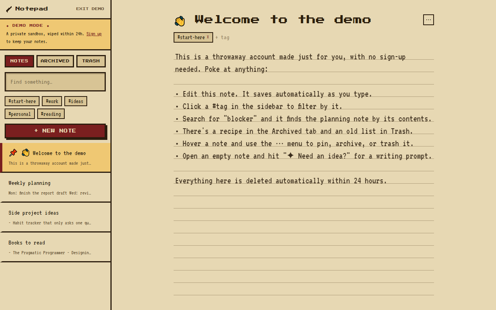
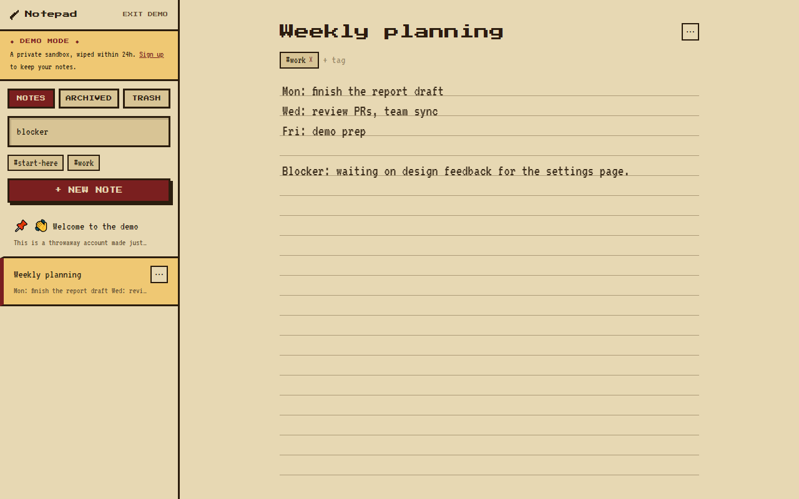
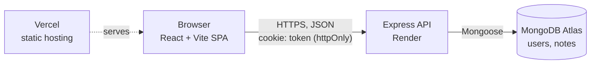

# Notepad App

**Live:** https://notepad-app-brown.vercel.app. Click **Try the Demo** to get a private sandbox account with sample notes, no sign-up needed.

Full-stack notepad: React + Express + MongoDB. Sign up, then write, tag, search, pin, archive, and trash/restore your own notes, all scoped to your account.


> The backend runs on Render's free tier, which sleeps after 15 minutes idle. If the app hasn't been visited recently, the first request can take 30-60 seconds to wake it up. The demo button says so if it's taking a while.

## Features

- **Accounts:** email + password sign-up, sessions in an httpOnly cookie
- **One-click demo:** a throwaway account per visitor, seeded with sample notes and deleted automatically after 24 hours
- **Notes:** autosave while typing, pin to top, tags with sidebar filtering
- **Full-text search** across titles and bodies (MongoDB text index)
- **Archive and Trash:** soft delete with restore, or delete forever
- **Writing prompts:** "Need an idea?" suggests a prompt matched to the note's tags

## Screenshots

| Landing | Notes (demo mode) | Search |
|---|---|---|
|  |  |  |

## Architecture



- `frontend/`: React 19 (Vite) + Tailwind 4, React Router, axios with `withCredentials`
- `backend/`: Express, Mongoose models, JWT auth middleware, controllers per resource

| Method | Route | What it does |
|---|---|---|
| POST | `/api/auth/signup`, `/login`, `/logout` | Session lifecycle (sets / clears the cookie) |
| POST | `/api/auth/demo` | Creates and logs into a seeded throwaway account |
| GET | `/api/auth/me` | Current user (used on page load to restore the session) |
| GET | `/api/notes?q=&tag=&archived=&trash=` | List notes, pinned first, then most recently edited |
| POST / PATCH | `/api/notes`, `/api/notes/:id` | Create, edit, pin, tag, archive |
| DELETE | `/api/notes/:id` | Move to trash (soft delete) |
| POST | `/api/notes/:id/restore` | Restore from trash |
| DELETE | `/api/notes/:id/permanent` | Delete forever |

## Decisions

**JWT in an httpOnly cookie, not localStorage.** Anything in localStorage can be read by any script on the page, so a single XSS bug would leak every session. An httpOnly cookie can't be read from JavaScript at all; the browser just attaches it to API requests.

**Cookie settings differ between dev and prod.** In production the frontend (Vercel) and API (Render) are on different domains, so the cookie is cross-site. Browsers only send cross-site cookies marked `SameSite=None`, and only accept `SameSite=None` together with `Secure` (HTTPS). Locally, Vite proxies `/api` so everything is same-origin, and `SameSite=Lax` works without HTTPS on localhost. CORS allows exactly one origin (`CLIENT_ORIGIN`) with credentials, never a wildcard.

**Every query is scoped to the logged-in user.** Notes are always looked up by `{ _id, userId }`, so a note that belongs to someone else returns 404, the same as one that doesn't exist. This avoids revealing which IDs exist.

**Soft delete for Trash.** Trashing a note sets `deletedAt` instead of removing it, so restore is just clearing that field. Deleting forever is a separate, explicit endpoint.

**Indexes match the queries.** A compound `{ userId, deletedAt }` index serves the list views. A text index on `title` + `body` powers search, so search matches whole words with stemming ("blockers" finds "blocker") instead of running a slow regex over every note.

**Debounced writes.** The editor saves 500 ms after you stop typing, and search fires 300 ms after the last keystroke. That's one request per pause instead of one per keystroke.

**Demo accounts are per-visitor and clean themselves up.** A single shared demo login would show every visitor everyone else's edits (and whatever they typed). Instead, each click on **Try the Demo**:
1. creates a fresh user with an unusable random password and seeds six sample notes that show off each feature;
2. stamps the user and the notes with `expiresAt`, and MongoDB **TTL indexes** delete them automatically after 24 hours. Real accounts never have the field, so they never expire;
3. issues a 24-hour JWT with `demo: true`, so notes the visitor creates get the same expiry;
4. wipes the account immediately on **Exit Demo** instead of waiting for the TTL.

The endpoint is rate-limited to 10 accounts per IP per hour so the free-tier database can't be flooded. Express trusts Render's proxy so the limit sees real client IPs.

**Writing prompts are a static list, not an AI call.** Prompts are picked from curated pools matched to the note's tags. There's no API cost or latency, and it works offline.

**Free-tier hosting, with the trade-off made visible.** Vercel + Render + Atlas M0 costs nothing. The catch is Render's cold start, so the demo button shows a "waking up the server" message after 3 seconds instead of a silent spinner.

## Local setup

### 1. MongoDB Atlas

Create a free M0 cluster at https://www.mongodb.com/cloud/atlas, add a database user, allow your IP (or `0.0.0.0/0` for dev), and copy the connection string.

### 2. Backend

```bash
cd backend
cp .env.example .env
# fill in MONGODB_URI and JWT_SECRET in .env
npm install
npm run dev
```

Runs on http://localhost:5000.

### 3. Frontend

```bash
cd frontend
npm install
npm run dev
```

Runs on http://localhost:5173 and proxies `/api` requests to the backend during dev.

## Deploy

Currently deployed as:

- **Frontend → Vercel**: root directory `frontend`, framework preset "Vite". Env var `VITE_API_URL` points at the Render backend (`https://<render-app>.onrender.com/api`).
- **Backend → Render**: root directory `backend`, build command `npm install`, start command `npm start`. Env vars: `MONGODB_URI`, `JWT_SECRET`, `CLIENT_ORIGIN` (the Vercel URL), `NODE_ENV=production`.
- **Database → MongoDB Atlas**: free M0 cluster, used by the Render backend via `MONGODB_URI`.

To fork and redeploy your own copy, follow the same setup: new Vercel project, new Render web service, new Atlas cluster, wiring the env vars above between them.
