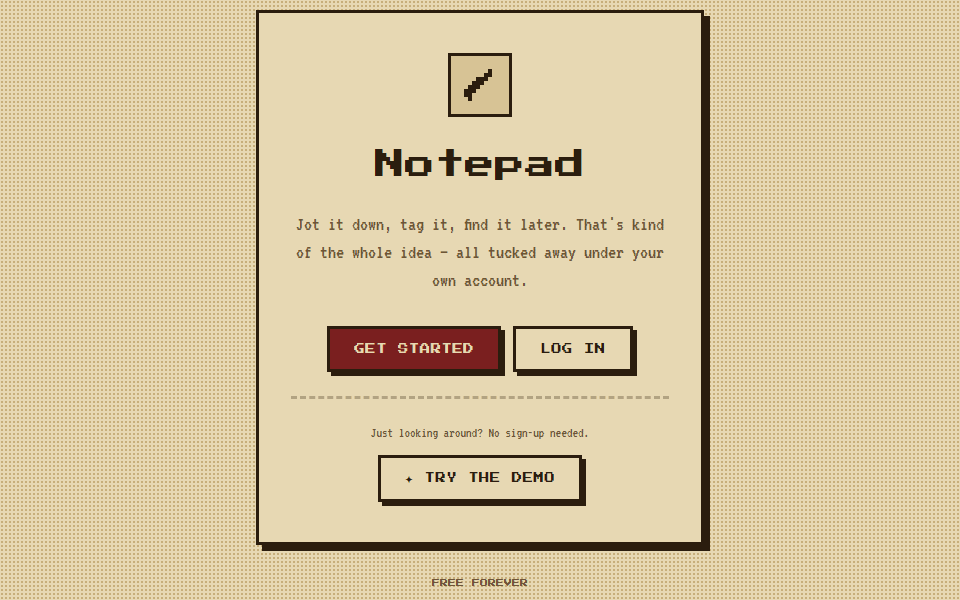
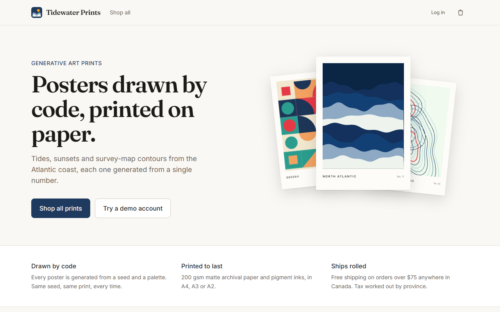
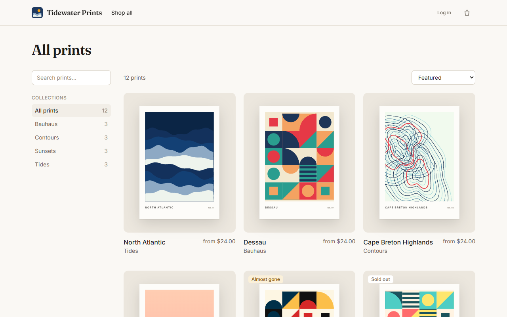
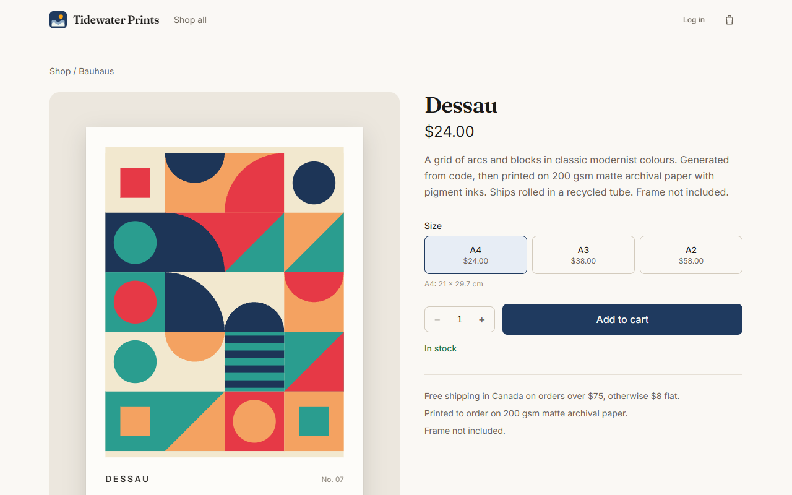
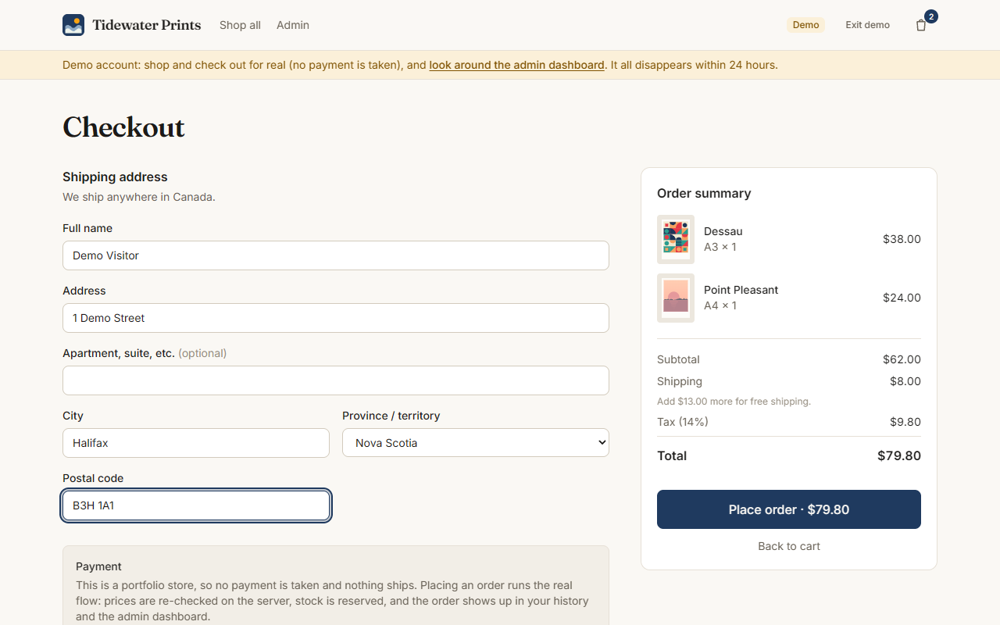
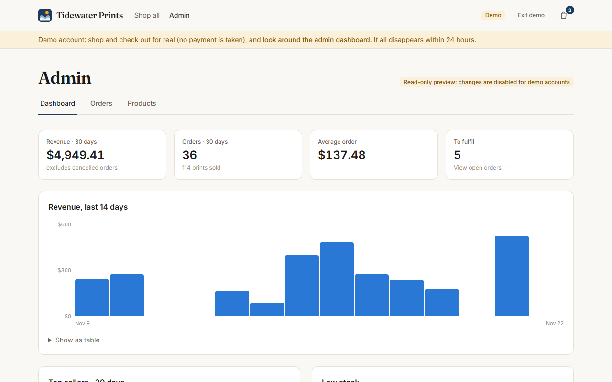
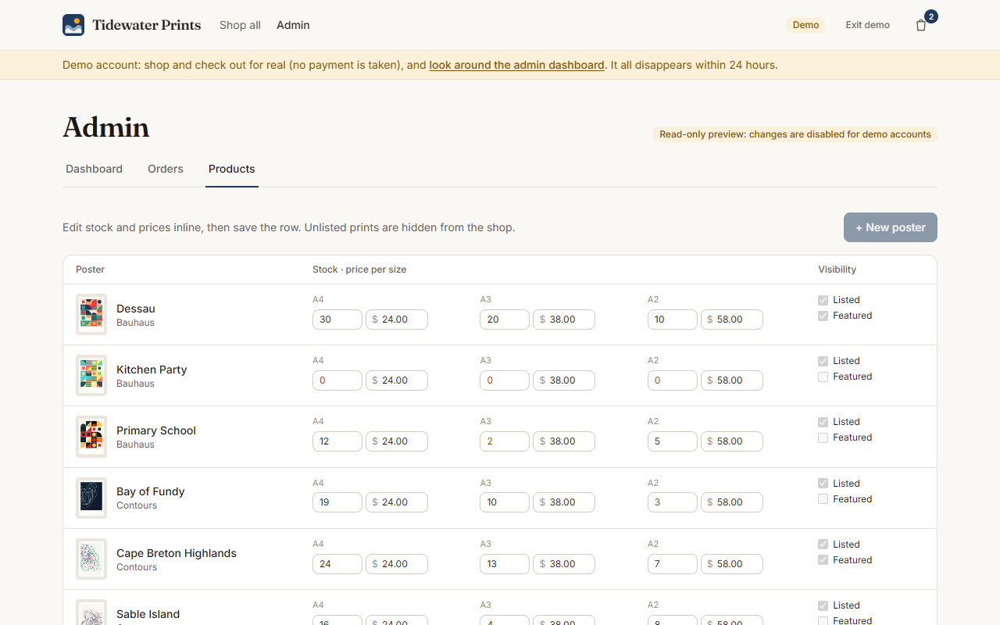
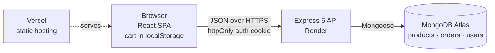

# Tidewater Prints

A full-stack e-commerce store for generative art posters: catalog, cart, checkout with Canadian tax, order history, and an admin dashboard for stock, orders and sales. React + Express + MongoDB.

**Live:** https://tidewater-prints.vercel.app. Click **Try a demo account** to shop, check out and look around the admin dashboard, no sign-up needed.

> Portfolio project: no payment is taken and nothing ships. Everything else (pricing, stock, orders, admin) is real.



> The backend runs on Render's free tier, which sleeps after 15 minutes idle. The first request after that can take 30-60 seconds; the demo button says so while it waits.

## Features

**Storefront**
- 31 posters in 4 collections (Bauhaus, Contours, Sunsets, Tides), each **generated in code** from a seed and a palette and rendered as SVG. No image files.
- Search, collection filters, and sorting, all kept in the URL so filtered views can be shared.
- Product pages with A4 / A3 / A2 sizes, per-size price and stock, "only 2 left" and sold-out states.
- Cart that works for guests (saved in the browser), with live server-side pricing.
- Checkout with Canadian postal-code validation, **tax by province** (GST / HST / PST / QST) and free shipping over $75.
- Order confirmation and order history.

**Admin** (role-based)
- Dashboard: 30-day revenue, orders, average order value, a 14-day revenue chart, top sellers, low-stock alerts, recent orders.
- Products: edit stock and prices inline, list/unlist, feature; create new posters with a **live generative preview**.
- Orders: filter by status, mark shipped, cancel (which puts the stock back).

**One-click demo**: a private throwaway account with order history that can shop for real and view the admin dashboard read-only. It deletes itself after 24 hours.

## Screenshots

| Home | Shop | Product |
|---|---|---|
|  |  |  |

| Checkout | Admin dashboard | Admin products |
|---|---|---|
|  |  |  |

## Architecture



| Method | Route | Who | What |
|---|---|---|---|
| GET | `/api/products?q=&collection=&sort=` | anyone | Catalog with filters |
| GET | `/api/products/:slug` | anyone | Product + related prints |
| POST | `/api/cart/quote` | anyone | Price a cart from the database (lines, problems, shipping, tax) |
| POST | `/api/orders` | signed in | Re-price, reserve stock, create the order |
| GET | `/api/orders`, `/api/orders/:id` | signed in | Your own orders only |
| POST | `/api/auth/signup`, `/login`, `/logout`, `/demo` | anyone | Sessions (httpOnly cookie) |
| GET | `/api/admin/stats`, `/orders`, `/products` | admin, demo (read-only) | Dashboard data |
| PATCH/POST | `/api/admin/orders/:id`, `/products`, `/products/:id` | admin | Ship/cancel orders, edit or create products |

## Decisions

**The server sets every price.** The cart only ever sends product ids, variant ids and quantities. `/cart/quote` and `/orders` look the prices up in the database, so a tampered request (`"priceCents": 1`) changes nothing. Money is integer cents end to end and is only turned into dollars for display.

**Stock can't be oversold.** Placing an order takes stock with one conditional update per line: `updateOne({ variant: id, stock: { $gte: qty } }, { $inc: { stock: -qty } })`. MongoDB applies each update atomically, so when two people buy the last poster at the same moment only one update matches; the other gets a clear "just sold out" error. If a later line in the same order fails, the lines already taken are put back. (Multi-document transactions would also work on Atlas; this approach needs no replica set, so it runs the same against a local `mongod`.) Cancelling an order returns its stock.

**Orders are snapshots.** Each order line copies the name, size, artwork and unit price at purchase time, so editing or deleting a product later never rewrites order history or receipts.

**Canadian tax and shipping.** Tax is worked out on the server from the shipping province (13% HST in Ontario, 14% in Nova Scotia, 5% GST + 7% PST in BC, and so on). It applies to subtotal plus shipping, because shipping is taxable in Canada. Postal codes are validated against the real format (no D, F, I, O, Q or U), then normalized to `B3H 4R2`.

**Posters are drawn by code.** A product stores a recipe, `{ style, seed, palette }`, not an image. The client draws it as SVG with a seeded random generator (mulberry32), so the same seed always produces the same poster. The upshot: no image hosting, no stock photo licensing, crisp at any size, and the admin can design a new poster with a live preview.

**Guest cart, signed-in checkout.** The cart lives in `localStorage` so visitors can shop before signing up. Its stored prices are only used for instant display; the server re-prices on every change. Checkout needs an account (or a demo account), so every order belongs to someone who can look it up later.

**Admin is a role, checked on every request.** Accounts listed in the `ADMIN_EMAILS` env var get the `admin` role at sign-up or login. The API reads the role from the database on each admin request instead of trusting the token, so revoking access takes effect immediately. Customers asking for another person's order get a 404, the same as for an order that doesn't exist.

**The demo can't break the shop for everyone else.** Each visitor gets a private throwaway account, seeded with two past orders. Demo orders check stock but don't consume it, so visitors can't empty the shop. Demo accounts can browse the admin dashboard, but every admin write is refused. MongoDB TTL indexes delete demo users and orders after 24 hours, and **Exit demo** deletes them immediately. Demo creation is rate limited per IP.

**The catalog lives in code and syncs itself.** On startup the server adds any catalog poster that isn't in the database yet (matched by slug), so a fresh database gets the whole catalog and newly added posters go live on the next deploy. Existing products are never overwritten, so stock and price edits made in the admin are kept. A fresh database also gets ~30 sample orders spread over three weeks, so the dashboard has something to show. Sample orders are flagged and labelled in the admin. Set `SEED_SAMPLE_ORDERS=false` to skip them.

**Auth.** JWTs live in an httpOnly cookie, so page scripts can't read them. In production the frontend and API are on different domains, so the cookie is `SameSite=None; Secure`. Locally, Vite proxies `/api` and `Lax` works without HTTPS. CORS allows exactly one origin.

**Validation and errors.** Every request body is validated with zod, and bad input gets a 400 naming the field (`shippingAddress.postalCode: Enter a valid Canadian postal code`). Express 5 forwards errors from async handlers to one error handler, which returns client errors as-is and hides server errors behind a generic 500.

## Local setup

1. **MongoDB:** create a free Atlas M0 cluster (or run `mongod` locally) and copy the connection string.
2. **Backend**
   ```bash
   cd backend
   cp .env.example .env   # set MONGODB_URI, JWT_SECRET, and your email in ADMIN_EMAILS
   npm install
   npm run dev            # http://localhost:5000, seeds the catalog on first run
   ```
3. **Frontend**
   ```bash
   cd frontend
   npm install
   npm run dev            # http://localhost:5173, proxies /api to the backend
   ```
4. Sign up with the email you put in `ADMIN_EMAILS` to get the **Admin** link.

## Deploy

- **Frontend → Vercel**: root directory `frontend`, preset "Vite", env var `VITE_API_URL=https://<render-app>.onrender.com/api`.
- **Backend → Render**: root directory `backend`, build `npm install`, start `npm start`. Env vars: `MONGODB_URI`, `JWT_SECRET`, `CLIENT_ORIGIN` (the Vercel URL), `NODE_ENV=production`, `ADMIN_EMAILS`.
- **Database → MongoDB Atlas** free M0 cluster.

## What's next

- Real payments with Stripe Checkout in test mode (card details handled by Stripe, order confirmed by webhook).
- Automated tests (Vitest + Supertest for pricing, stock and permissions; a Playwright run of the checkout) in GitHub Actions.
- Moving the API onto Vercel functions to remove the cold start.
